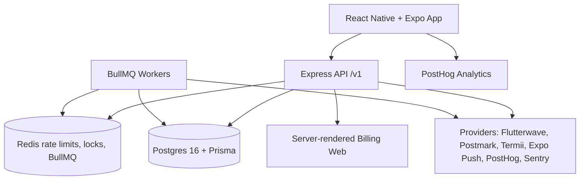

# Architecture

This document describes the Rota system architecture as implemented in this monorepo. See [AGENTS.md](AGENTS.md) for build rules and [docs/Rota_PRD_v2.md](docs/Rota_PRD_v2.md) for requirements.

## System overview

## Monorepo layout

| Path | Purpose |
|---|---|
| `apps/api/` | Express + TypeScript API under `/v1` |
| `apps/mobile/` | React Native + Expo app (Expo Router) |
| `packages/shared/` | Zod schemas, types, roles, error/warning codes |
| `docs/` | Supporting docs |

## API layers (four layers)

Per AGENTS.md S-1:
1. **Route** (`modules/*/*.routes.ts`) - thin HTTP handlers
2. **Validation** (Zod) - request boundaries
3. **Service** (`modules/*/*.service.ts`) - business rules (server authority)
4. **Repository** (`modules/*/*.repository.ts`) - only layer importing Prisma

## Data model

- **Postgres 16 + Prisma**. Raw SQL for partial unique indexes and CHECK constraints (L-4).
- **Soft deletes** via Prisma client extension filtering `deletedAt` for User, Business, Location (D-8).
- **Money** integer kobo everywhere (M-1). Math in `modules/billing` only (S-5). Conversions in `lib/money.ts` from Flutterwave adapter only (M-2).
- **Time** UTC; location IANA timezone; availability location-local minutes; time off location-local dates (D-1).
- **Immutable ledger** `BillingLedger` (append-only; trigger blocks updates/deletes except purge flag).

## Auth & authorization

- **Passwords** argon2id (P-1). **Access** JWT 15 min. **Refresh** opaque hashed rotated 30 days; reuse revokes (P-2).
- **Device trust** via `Device.trustedAt` (P-3). Unknown device needs email code.
- **Codes**: email 10 min, 6th wrong invalidates (P-4). Invites 7 days, 5th wrong locks.
- **Enforcement**: role from membership per request (A-1), business scoped (A-2), server-side permission matrix (A-3), role limits (A-4).
- **Rate limiting**: Redis-backed auth 5/min per IP+email, others 120/min per user (P-7).

## Background jobs

BullMQ workers in `apps/api/src/worker.ts` (S-2). Queues: notifications, swap-expiry, ack-reminders, shift-reminders, push-receipts, token-cleanup, billing-webhooks, billing-lifecycle, push. Handlers idempotent (L-4b).

## Providers

Only under `apps/api/src/providers/` (S-3): Flutterwave (payments, interface + adapter, hosted checkout only L-5/L-6/L-7), Postmark/SMTP (email), Termii (SMS invites), Expo Push, PostHog (6 events P-8), Sentry.

## Billing

Plans seeded. Checkout via Flutterwave. Webhooks follow M-10. Immutable ledger. Seats from open `SeatPeriod` (M-7). Proration floors per line ([docs/BILLING_PRORATION.md](docs/BILLING_PRORATION.md)). No in-app prices/buttons/links (M-5). Server-rendered billing web only (S-8).

## Mobile

Expo SDK 57, Expo Router, TanStack Query with persisted AsyncStorage cache (S-11). Offline reading (shifts 7d back/14d ahead, members, inbox). No Redux/global store. Tokens in expo-secure-store. API only to Rota API + PostHog.

## Security

See [SECURITY.md](SECURITY.md). No secrets in repo/mobile/logs, redaction, hashed tokens/codes, tenant isolation, rate limiting, webhook signature verification.
